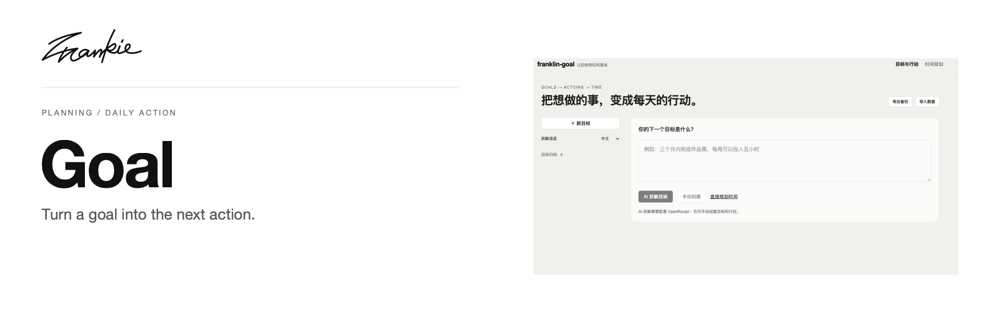

# Frankie Goal

Break what you want to do into actions, then make room to start each day.

[Guide (中文)](docs/guide.md) · [Run locally](#run-locally) · [中文](README.zh-CN.md)

## What it does

- Break goals into stages and actions while retaining their source, dependencies and completion criteria.
- Plan daily actions within available time and surface one thing you can start today.
- Keep plans organized with notes, local storage and JSON backups.

## Run locally

Requires Node.js 22.18+ or Node.js 24+. For a fresh checkout:

```sh
npm ci
cp .env.example .env.local
npm run dev
```

Open http://localhost:3000. AI decomposition uses the server-side `OPENROUTER_API_KEY`; select a model through `OPENROUTER_MODEL`.

## Before you start

You can manage goals, actions, schedules and backups manually without an API key. Data stays in this browser, with no account or cloud sync. Legacy imports and parent/child task migration are covered in the project guide.

## For developers

```sh
npm run typecheck
npm test
npm run build
```

[Project guide (中文)](docs/guide.md) · [Artwork](docs/readme/README.md)

---

Made by [Songhai Fan](https://github.com/SonghaiFan) · A Frankie project
