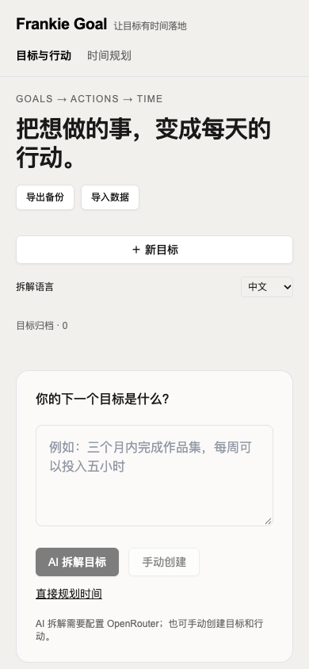

<h1 align="center"><picture><source media="(prefers-color-scheme: dark)" srcset=".github/brand/icon-dark.svg"></picture><br>Frankie Goal</h1>

<p align="center"><b>把想做的事拆成行动，再为每天留出可以开始的时间。</b></p>

<p align="center"><a href="https://songhaifan.github.io/frankie-goal/zh/">项目介绍</a> · <a href="https://frankie-goal.vercel.app">打开应用</a> · <a href="docs/guide.md">使用指南</a> · <a href="README.md">English</a></p>

<p align="center"></p>

## 可以做什么

- 拆解目标、阶段和行动，保留来源、依赖与完成标准。
- 按可用时间滚动安排每日行动，先看今天能开始的一件事。
- 用笔记、本地保存和 JSON 备份持续整理计划。

## 本地运行

需要 Node.js 22.18+ 或 Node.js 24+。首次配置时：

```sh
npm ci
cp .env.example .env.local
npm run dev
```

打开 http://localhost:3000。AI 拆解使用服务端 `OPENROUTER_API_KEY`；模型可通过 `OPENROUTER_MODEL` 配置。

## 开始之前

不配置 key 也可以手动管理目标、行动、日程和备份。数据保存在当前浏览器，没有账户或云端同步。旧数据导入和父子任务迁移规则见项目指南。

## 开发说明

```sh
npm run typecheck
npm test
npm run build
```

[项目指南](docs/guide.md) · [Banner 维护](docs/readme/README.md)

---

<!-- series-footer:start -->

<p align="center">
<a href="https://songhaifan.github.io/frankie-brain/"></a> &nbsp; <a href="https://songhaifan.github.io/frankie-cards/"></a> &nbsp; <a href="https://songhaifan.github.io/frankie-dictionary/"></a> &nbsp; <a href="https://songhaifan.github.io/frankie-generative-art/"></a> &nbsp; <a href="https://songhaifan.github.io/frankie-goal/"></a> &nbsp; <a href="https://songhaifan.github.io/frankie-guitar/"></a> &nbsp; <a href="https://songhaifan.github.io/frankie-list/"></a> &nbsp; <a href="https://songhaifan.github.io/frankie-mbti/"></a> &nbsp; <a href="https://songhaifan.github.io/frankie-onitama/"></a> &nbsp; <a href="https://songhaifan.github.io/frankie-owspace-api/"></a> &nbsp; <a href="https://songhaifan.github.io/frankie-poker/"></a> &nbsp; <a href="https://songhaifan.github.io/frankie-stocks/"></a> &nbsp; <a href="https://songhaifan.github.io/frankie-tarot/"></a> &nbsp; <a href="https://songhaifan.github.io/frankie-tarot-api/"></a> &nbsp; <a href="https://songhaifan.github.io/frankie-werewolf/"></a>
</p>

<p align="center"><sub>Frankie series · Made by <a href="https://github.com/SonghaiFan">Songhai Fan</a></sub></p>

<!-- series-footer:end -->

<p align="right"><picture><source media="(prefers-color-scheme: dark)" srcset=".github/brand/signature-dark.svg"></picture></p>
