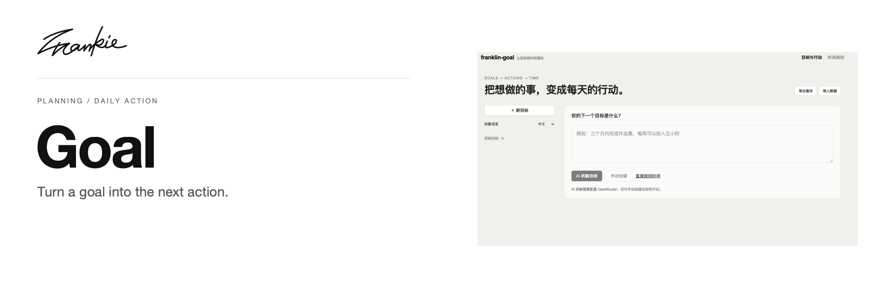

# Frankie Goal

把想做的事拆成行动，再为每天留出可以开始的时间。

[English](README.md) · [Guide](docs/guide.md) · [Run locally](#run-locally)

## What it does

- 拆解目标、阶段和行动，保留来源、依赖与完成标准。
- 按可用时间滚动安排每日行动，先看今天能开始的一件事。
- 用笔记、本地保存和 JSON 备份持续整理计划。

## Run locally

需要 Node.js 22.18+ 或 Node.js 24+。首次配置时：

```sh
npm ci
cp .env.example .env.local
npm run dev
```

打开 http://localhost:3000。AI 拆解使用服务端 `OPENROUTER_API_KEY`；模型可通过 `OPENROUTER_MODEL` 配置。

## Before you start

不配置 key 也可以手动管理目标、行动、日程和备份。数据保存在当前浏览器，没有账户或云端同步。旧数据导入和父子任务迁移规则见项目指南。

## For developers

```sh
npm run typecheck
npm test
npm run build
```

[Project guide](docs/guide.md) · [Artwork](docs/readme/README.md)

---

Made by [Songhai Fan](https://github.com/SonghaiFan) · A Frankie project
